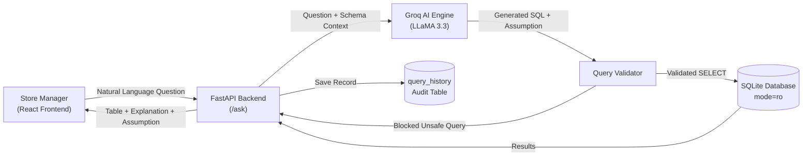
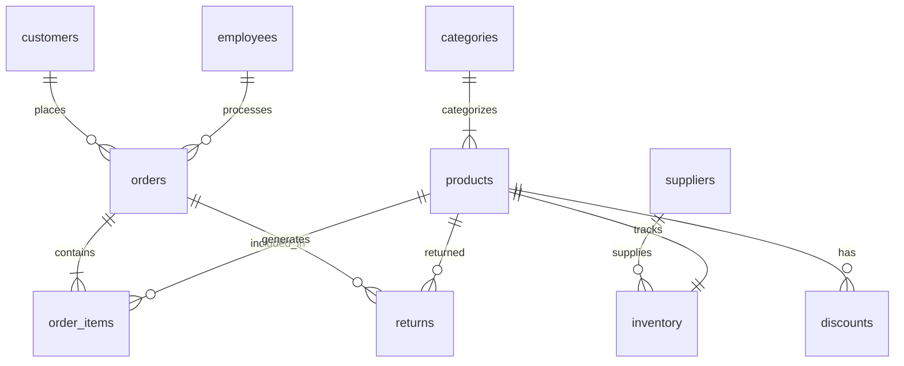

# QuickKart Analytics

A self-serve Text-to-SQL analytics tool that allows retail store managers to ask business questions in plain English and get instant answers from their store database.

---

## Application Interface

### Search Interface & Suggested Questions


### Generated SQL, Business Assumptions & Results Table


### Schema Explorer & Query History Panel


---

## 1. Business Problem

Store managers and inventory teams need answers to daily operational questions:
* Which products are below the reorder level?
* Which items have high return rates this month?
* Which cashiers handled the most orders today?

Store managers do not know SQL, so they typically request ad-hoc reports from a central data team and wait 2 to 3 days. QuickKart allows managers to query the store database directly in plain English with sub-second response times.

---

## 2. System Architecture



### How It Works
1. **Schema Context Injection:** The backend injects the table structures and relationships into the prompt.
2. **SQL & Assumption Generation:** LLaMA 3.3 writes the SQL query along with a one-line business assumption (for example: *"Assuming top customers means highest total spend"*).
3. **Safety Validation:** The backend checks that only a single `SELECT` statement is executed, and blocks any modification commands (`DROP`, `DELETE`, `UPDATE`, `INSERT`).
4. **Read-Only Database:** Queries execute against SQLite in read-only mode (`mode=ro`), physically preventing any data changes.
5. **Self-Healing Retry:** If a query fails with a syntax error, the backend sends the error back to the model once to self-correct before returning a response.
6. **Audit History:** Every question, generated SQL query, row count, and timestamp is logged into the `query_history` table.

---

## 3. Database Schema (11 Tables)

QuickKart models a retail supermarket database across 10 operational tables and 1 audit table:



### Table Reference

| Table | Primary Key | Foreign Keys | Key Columns | Purpose |
| :--- | :--- | :--- | :--- | :--- |
| **`customers`** | `customer_id` | - | `name`, `city`, `phone`, `loyalty_points` | Customer profiles and loyalty balances |
| **`categories`** | `category_id` | - | `name`, `description` | Product departments (Dairy, Snacks, Beverages) |
| **`suppliers`** | `supplier_id` | - | `name`, `city`, `rating` | Vendor directory and supplier ratings |
| **`employees`** | `employee_id` | - | `name`, `role`, `salary`, `shift` | Staff profiles, cashiers, and managers |
| **`products`** | `product_id` | `category_id` | `name`, `brand`, `price`, `cost_price`, `unit` | Product catalog and pricing |
| **`inventory`** | `inventory_id` | `product_id`, `supplier_id` | `quantity_in_stock`, `reorder_level` | Stock levels and restock thresholds |
| **`orders`** | `order_id` | `customer_id`, `employee_id` | `order_date`, `total_amount`, `payment_method` | Checkout transactions |
| **`order_items`** | `item_id` | `order_id`, `product_id` | `quantity`, `unit_price`, `subtotal` | Line-item details per order |
| **`discounts`** | `discount_id` | `product_id` | `label`, `discount_percent`, `start_date`, `end_date` | Active promotional offers |
| **`returns`** | `return_id` | `order_id`, `product_id` | `return_date`, `reason`, `refund_amount` | Customer returns and refund tracking |
| **`query_history`** | `id` | - | `question`, `sql_query`, `result_count`, `created_at` | Audit log of all questions asked |

---

## 4. Security & Query Safety

* **Read-Only Database Connection:** Analytical queries run over SQLite using URI parameter `?mode=ro`. The database engine itself physically rejects any write or update attempts.
* **Single-Statement Rule:** Blocks queries with multiple statements or semicolons (e.g. `SELECT ...; DROP TABLE ...`).
* **Blocked Modification Commands:** Rejects statements containing `DROP`, `DELETE`, `UPDATE`, `INSERT`, `ALTER`, or `PRAGMA`.
* **Row Limit:** Automatically limits results to 500 rows if no limit is specified to keep queries fast.
* **Audit Logging:** Saves every user question and the executed SQL in `query_history` on a separate connection.

---

## 5. Testing

Run the safety checks:

```bash
python tests/test_safety.py
```

Tests verify that:
* Valid `SELECT` queries pass.
* Multi-statement injections (`;`) are rejected.
* `DROP`, `DELETE`, and `UPDATE` statements are blocked.
* The read-only connection physically rejects direct write operations.

---

## 6. Limitations

* **Sample Data Volume:** Contains ~500 seed records modeled on Indian retail operations for demonstration purposes.
* **Ambiguity Handling:** Plain English questions can be subjective (e.g., "best customer"). QuickKart displays an explicit assumption with each result to show how the question was interpreted.
* **Authentication:** Built as an internal prototype without user authentication or role-based access control.
