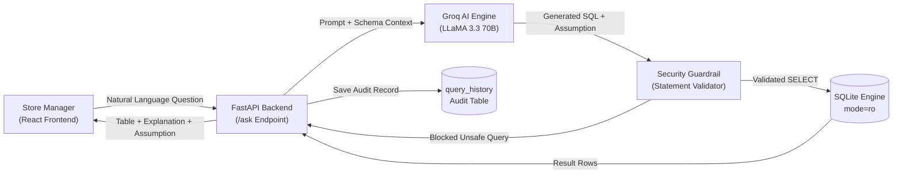

# QuickKart Analytics

A self-serve Text-to-SQL analytics platform that translates natural language business questions into validated SQL queries against an indexed retail database schema, providing store managers with immediate operational answers and query explanations.

---

## Application Interface

### Operational Search Interface & Suggested Inquiries


### Synthesized SQL, Business Assumptions & Results Table


### Schema Explorer & Historical Query Audit Trail


---

## 1. Business Problem & Product Context

### The Operational Bottleneck
In supermarket and retail chain operations, store managers and inventory leads require fast answers to daily business questions:
* Identifying products falling below warehouse reorder thresholds.
* Reviewing customer return volumes and refund losses across categories.
* Auditing cashier transaction counts and peak checkout times.

Traditionally, non-technical operational staff rely on central Data Engineering or BI teams to write ad-hoc SQL reports, creating a 2- to 3-day turnaround bottleneck for routine operational decisions.

### Product Objectives & Success Metrics
* **Query Latency:** Reduce data inquiry turnaround from days to sub-second execution (<500ms).
* **Self-Service Adoption:** Enable non-technical managers to query store data without SQL training.
* **Interpretation Transparency:** Every AI query returns the executed SQL, an explanation, and a stated business assumption (e.g., whether "top customers" represents purchase count or total lifetime spend).
* **Data Protection:** Enforce strict read-only execution guardrails to prevent accidental mutations or malicious data modifications.

---

## 2. System Architecture & Data Flow



### Architectural Workflow
1. **Schema Context Injection:** When a question is submitted, `backend/schema.py` injects the relational database structure, primary/foreign key relationships, and generation rules into the prompt.
2. **SQL & Assumption Generation:** LLaMA 3.3 synthesizes a single `SELECT` query along with an explicit business assumption resolving potential semantic ambiguities.
3. **Security Guardrail:** The backend validates that exactly one SQL statement is present, rejects data modification statements (`DROP`, `DELETE`, `UPDATE`, `INSERT`, `ALTER`, `PRAGMA`), and enforces a 500-row safety limit.
4. **Read-Only Database Execution:** Analytical queries run over an isolated SQLite connection opened in physical read-only mode (`mode=ro`) with a query execution timeout.
5. **Self-Healing Error Recovery:** If database execution encounters a syntax error, the backend routes the error message back to the model once to self-correct the query before failing safely.
6. **Governance Audit Logging:** Executed questions, generated SQL queries, execution timestamps, and row counts are recorded in an audit table (`query_history`) on a separate write connection.

---

## 3. Relational Database Schema (11 Tables)

QuickKart structures an Indian retail supermarket domain across 10 operational entity tables and 1 audit table:

### Entity Relationship Structure
```
customers ──────────< orders >────────── employees (cashier)
                         │
                         └──< order_items >── products ──< categories
                                                 │
                                             inventory >── suppliers
                                                 │
                                             discounts
                         │
                         └──< returns >────── products

query_history (Dedicated Governance & Audit Table)
```

### Table Definitions

| Table | Primary Key | Foreign Keys | Key Attributes | Purpose |
| :--- | :--- | :--- | :--- | :--- |
| **`customers`** | `customer_id` | - | `name`, `city`, `phone`, `loyalty_points` | Customer profiles and loyalty balances |
| **`categories`** | `category_id` | - | `name`, `description` | Retail product classifications (Dairy, Snacks, etc.) |
| **`suppliers`** | `supplier_id` | - | `name`, `city`, `rating` | Supplier directory and vendor quality ratings |
| **`employees`** | `employee_id` | - | `name`, `role`, `salary`, `shift` | Staff members, cashiers, and store managers |
| **`products`** | `product_id` | `category_id` | `name`, `brand`, `price`, `cost_price`, `unit` | Merchandise catalog, pricing, and cost |
| **`inventory`** | `inventory_id` | `product_id`, `supplier_id` | `quantity_in_stock`, `reorder_level` | Stock tracking and replenishment thresholds |
| **`orders`** | `order_id` | `customer_id`, `employee_id` | `order_date`, `total_amount`, `payment_method` | Transaction headers and checkout records |
| **`order_items`** | `item_id` | `order_id`, `product_id` | `quantity`, `unit_price`, `subtotal` | Individual line-items per order |
| **`discounts`** | `discount_id` | `product_id` | `label`, `discount_percent`, `start_date`, `end_date` | Active promotional pricing campaigns |
| **`returns`** | `return_id` | `order_id`, `product_id` | `return_date`, `reason`, `refund_amount` | Returned items, reasons, and refund values |
| **`query_history`** | `id` | - | `question`, `sql_query`, `result_count`, `created_at` | Audit trail for security and monitoring |

---

## 4. Security & Defensive Engineering

1. **Physical Engine Isolation:** Queries run against SQLite using URI parameter `?mode=ro`. Even if input circumvents string inspection, the database engine physically rejects write operations with an `attempt to write a readonly database` error.
2. **Statement Boundary Validation:** Input is validated to ensure exactly one statement exists; semicolon chaining (`SELECT ...; DROP TABLE ...`) is blocked with an HTTP 400 response.
3. **Keyword Filtering:** Any statement containing mutation tokens (`DROP`, `DELETE`, `UPDATE`, `INSERT`, `ALTER`, `ATTACH`, `PRAGMA`) is rejected before execution.
4. **Query Timeout & Row Capping:** Queries default to a maximum limit of 500 rows to prevent memory exhaustion, with a 5.0-second execution timeout.
5. **Dual-Engine Failover:** Supports local SQLite execution out of the box, with automatic detection and failover to PostgreSQL when configured.

---

## 5. Verification & Unit Testing

A test suite covers the SQL validator and database access boundaries:

```bash
# Run security test suite
python tests/test_safety.py
```

### Test Coverage
* `test_valid_select_allowed`: Confirms standard multi-table SELECT queries execute cleanly.
* `test_blocks_multiple_statements`: Validates rejection of semicolon-separated statement chains.
* `test_blocks_drop_table`: Verifies rejection of table destruction commands.
* `test_blocks_delete_statement`: Verifies rejection of row deletion statements.
* `test_blocks_update_statement`: Verifies rejection of data mutation statements.
* `test_readonly_connection_blocks_direct_writes`: Validates that SQLite's physical engine enforces write rejection on read-only connections.

---

## 6. Assumptions & Limitations

* **Synthetic Data Volume:** The database contains ~500 realistic seed records modeled on Indian retail operations, ideal for query demonstration without multi-gigabyte storage overhead.
* **Single-Schema Scope:** Prompt context is optimized for the retail store schema; cross-database federation or multi-tenant isolation is not implemented.
* **LLM Semantic Ambiguity:** Natural language terms like "best" or "active" are inherently subjective. QuickKart addresses this by generating and displaying an explicit business assumption with every query.
* **Authentication:** Designed as an internal operations tool prototype; role-based access control (RBAC) and user authentication should be introduced prior to production deployment.

---

## 7. How to Run Locally

### Prerequisites
* Python 3.10+
* Node.js 16+ and npm

### 1. Backend Setup
```bash
cd backend

# Install dependencies
pip install -r requirements.txt

# Configure environment (optional: add your Groq API key)
cp .env.example .env

# Run database setup (creates quickkart.db with seed records)
python setup_db.py

# Start FastAPI server
uvicorn main:app --reload --port 8000
```
Backend API runs at: `http://localhost:8000`

### 2. Frontend Setup
```bash
cd frontend

# Install packages
npm install

# Start React development server
npm start
```
Frontend application runs at: `http://localhost:3000`

---

## 8. Summary of Engineering Improvements

| Category | Initial Implementation | Refined Production Pattern |
| :--- | :--- | :--- |
| **Database Access** | Read-write SQLite connection for all queries | Read-only connection (`mode=ro`) with separate audit connection |
| **SQL Validation** | Basic `.startswith("SELECT")` prefix check | Strict single-statement enforcement and mutation keyword blocking |
| **Semantic Handling** | Raw SQL output without explanation of intent | Stated business assumptions displayed under results in the UI |
| **Error Handling** | Unhandled 500 error on query execution failure | 1-attempt self-healing retry followed by friendly error messages |
| **Test Verification** | No automated tests | Automated unit tests validating safety guardrails and read-only behavior |
| **Documentation** | Casual documentation with emojis | Professional documentation with architecture diagram and schema reference |
